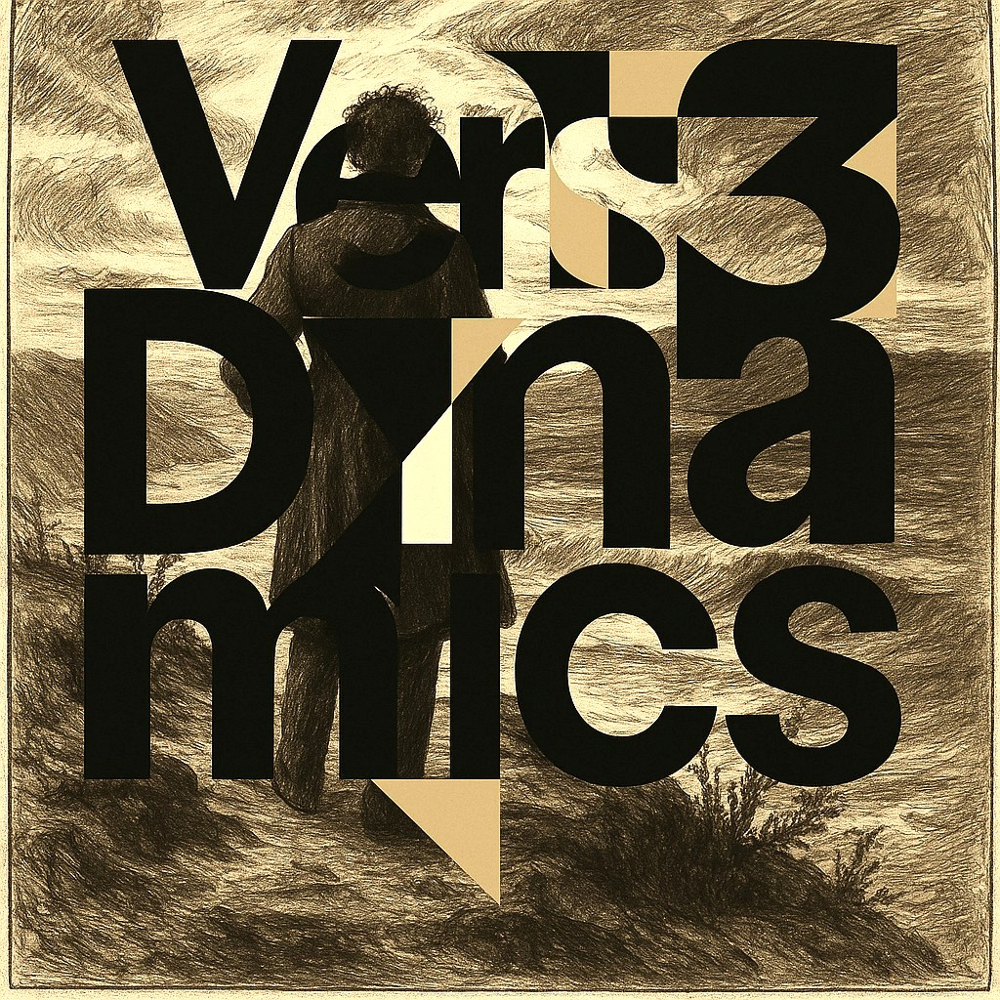

<div align="center">
  
</div>

# Vers3Dynamics Studio

**Make a sound. Touch its shape. Hear the gesture return.**

An experimental browser instrument from [Vers3Dynamics](https://vers3dynamics.com/). A digital vinyl deck, a Web Audio soundscape, realtime waveform and spectrogram displays, and a field of moving geometry share one stage. The screen responds to audio; your hands change the sound through the virtual record.

**[Enter the studio →](https://vers3dynamics-studio.vercel.app/)** · [Get it running locally](#run-locally) · [What actually works](#what-actually-works) · [Inside the instrument](#inside-the-instrument) · [Known gaps](#known-gaps)

> The point is not to make a machine sound human. It is to make the relationship between movement, sound and attention something you can explore.

## Try it in one minute

1. **Open the [studio](https://vers3dynamics-studio.vercel.app/).** Enable audio through a browser interaction if prompted.
2. **Play the instrument.** The current playback creates a built-in layered synthesizer arrangement using the Web Audio API.
3. **Touch the vinyl.** Moving the record while it is playing bends pitch, shifts filtering and changes volume. Surface noise responds to scratching.
4. **Watch the sound.** The waveform, spectrum and animated field respond to the audio signal.
5. **Change the view.** Explore the display, layout and theme; turn down the volume before experimenting with scratch gestures.

No account or AI model is required. As with other Web Audio experiences, playback depends on browser audio permissions and user interaction.

## What actually works

| Part | Current implementation | Evidence in the code |
| --- | --- | --- |
| Virtual vinyl | Drag interaction with signed scratch velocity; pitch, filter and gain respond in the running audio graph | [VinylPlayer](src/components/VinylPlayer.tsx) · [audio graph](src/pages/Index.tsx) |
| Sound engine | Layered bass, arpeggio, pad, modulation, delay, crackle and surface noise synthesized in browser | [Index](src/pages/Index.tsx) |
| Visualization | Frequency bars, time-domain waveform, spectrogram, animated visual effects | [AudioVisualizer](src/components/AudioVisualizer.tsx) · [EnhancedVisualizer](src/components/EnhancedVisualizer.tsx) |
| Code panel | Editable, syntax-highlighted sample patterns | [CodeEditor](src/components/CodeEditor.tsx) |
| Experience | Theme controls, fullscreen presentation and a discoverable audio interaction | [Studio page](src/pages/Index.tsx) |

**Important distinction:** the editor displays and allows changes to Strudel-like pattern text, but the current Play handler **does not evaluate that text**. It constructs its own fixed Web Audio oscillator arrangement. This is an interactive synthesizer and visual experience today, **not yet a working arbitrary-pattern Strudel live-coding environment**. The dependencies and editor are present, but connecting the language to the sound engine is still future implementation work.

### A mathematical question worth testing

**Does changing a displayed music pattern change the measured output spectrum as predicted?** The [proposed study](docs/MATH_RESEARCH.md) names assumptions, an existing baseline and a negative control. Candidate mathematics can be explored through [R.A.I.N.'s shared reference scout](https://github.com/topherchris420/lop-nur-twin/blob/main/docs/MATH_PORTFOLIO.md). **No additional mathematical capability has been demonstrated here yet.**

## Inside the instrument

```text
gesture on record ──► scratch velocity ──► pitch / filter / level
                                               │
built-in Web Audio voices ──► audio graph ──────┼──► speakers
                                               │
                                               └──► analyser
                                                       ├── waveform
                                                       ├── spectrum
                                                       └── reactive geometry

editable pattern panel ──► UI state (not yet audio evaluation)
```

The current visual language is *quantum-inspired*: waveforms, orbital motion and geometric fields are artistic representations, **not quantum-computing simulations or measurements**. Meyda is included for audio analysis; the playing instrument is built on the browser's audio graph rather than external physiological signals.

## Run locally

Requirements: a recent Node.js LTS release and npm.

```bash
git clone https://github.com/topherchris420/quantum-spin-sound.git
cd quantum-spin-sound
npm install
npm run dev
```

Open the local URL printed by Vite.

```bash
npm run lint
npm run build
npm run preview
```

The repository has Vite, React, TypeScript, CodeMirror, Three.js, Framer Motion, Meyda and Web Audio. It currently has **no automated test script** in `package.json`; `npm run lint` and `npm run build` are the available repository checks. A passing build does not prove audio compatibility in every browser.

## Known gaps

- **The code editor is not connected to playback.** The first substantive audio feature to implement is a true, evaluated pattern engine with lifecycle control, error feedback and safe stopping behavior.
- **Audio needs hands-on testing.** Automated build/lint checks cannot establish crackle levels, scratch ergonomics or accessibility across speakers, browsers and devices.
- **No biosignal input or validated human-state adaptation.** This is an audiovisual instrument, not a measurement device or a clinical intervention.
- **No committed demo screenshot or runtime GIF yet.** The logo above is an existing repository asset, not a depiction of the running interface.

## Where to build next

The clearest next experiment is small enough to falsify: edit one note in the pattern panel, press Play and verify whether the produced pitch changes. Today it does not. Connecting a documented Strudel evaluation path to actual note scheduling would make that test pass and move the experience from *sound with visible code* to *sound controlled by code*.

After that: a session export, reproducible sound-state capture, and optional documented control inputs. Keep the audio experience useful before claiming adaptation.

## Contribute

The [source](src/) is open for inspection. If you improve the audio engine, share a before/after recording, browser, reproduction steps and a description of how the code reaches the speaker. [Open an issue](https://github.com/topherchris420/quantum-spin-sound/issues) or propose a pull request.

## Credits and usage

Created within [Vers3Dynamics](https://vers3dynamics.com/). Built with browser-native Web Audio, [Strudel](https://strudel.cc/) ecosystem packages, [CodeMirror](https://codemirror.net/), [Meyda](https://meyda.js.org/) and [Lovable](https://lovable.dev/).

**License note:** the repository currently has no committed `LICENSE` file. A dependency's license does not automatically license the project's own source. Check with the author before reuse beyond what applicable law permits.

*Resonance as substrate. Intelligence as a layer. Here, the instrument is sound.*
